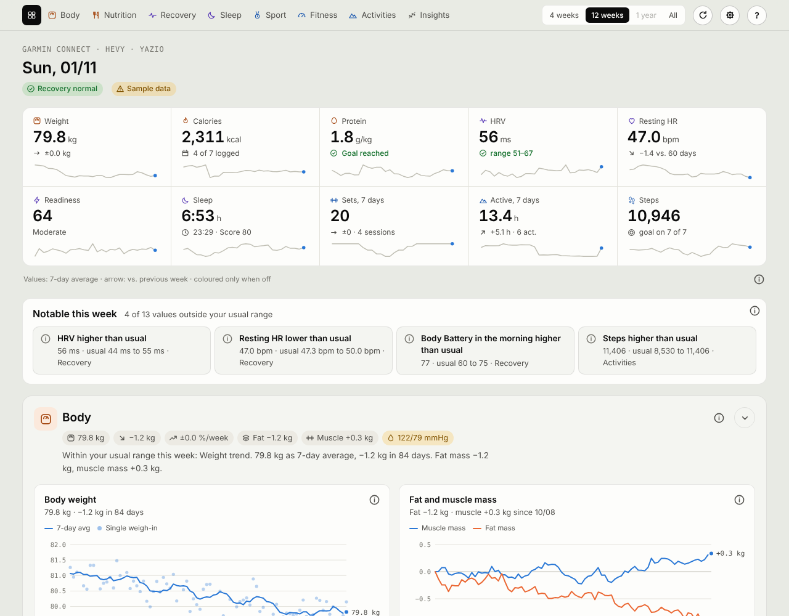
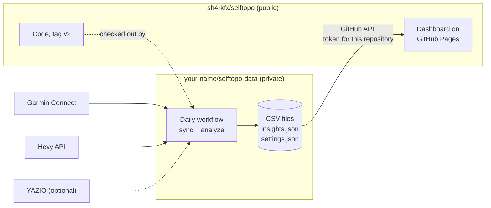
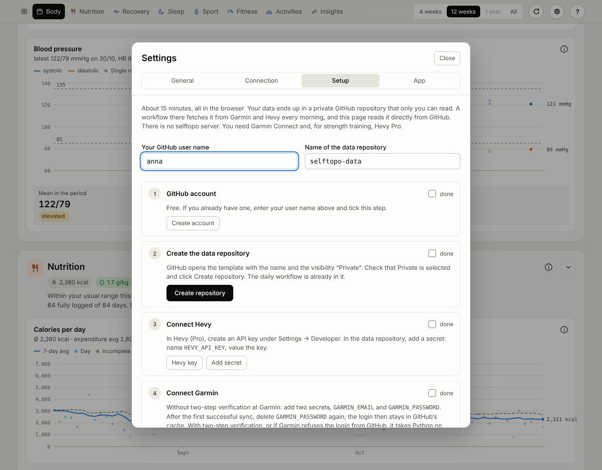
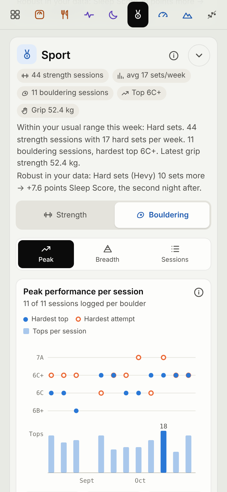
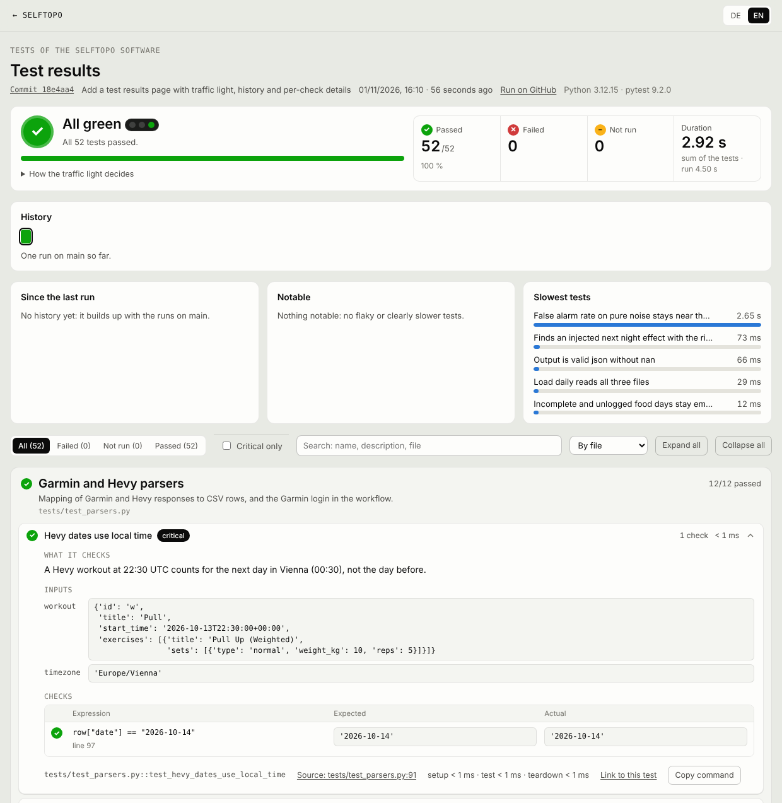

# selftopo

[](https://sh4rkfx.github.io/selftopo/dashboard/tests.html)

Your training, recovery, sleep, nutrition and body data in one place, with the relationships
between them. selftopo pulls daily health metrics and activities from Garmin Connect, workout sets
from Hevy and, optionally, food intake from YAZIO. It stores everything as plain CSV files in a
private GitHub repository you own, looks for time-lagged relationships in your own data and
shows it all on a static dashboard in German or English.

There is no selftopo server. Your data stays in your private repository and in your browser.

**[Live demo](https://sh4rkfx.github.io/selftopo/dashboard/)**: the dashboard with invented sample
data, no login or account needed.



| | |
|---|---|
| **Sources** | Garmin Connect (daily values, activities, bouldering, blood pressure, fitness metrics), Hevy (sets, exercises), YAZIO (optional, daily nutrition totals) |
| **Dashboard** | Eight areas: Body, Nutrition, Recovery, Sleep, Sport (strength and bouldering), Fitness, Activities, Insights, plus raw data. Installable as an app, works offline, German and English |
| **Notable this week** | Compares every weekly value with your own usual range and lists only what falls outside |
| **Insights** | Tests about 100 pairs such as *training load → HRV the next night* with a correction for multiple testing |
| **Setup** | In the browser with a guided setup, or locally with Python |
| **Cost** | Free: GitHub Free covers the private repository, Actions and Pages. Hevy's API needs Hevy Pro |

- [How it works](#how-it-works)
- [Setup](#setup)
- [The dashboard](#the-dashboard)
- [Settings](#settings)
- [Data sources](#data-sources)
- [Analysis](#analysis)
- [Running locally](#running-locally)
- [Troubleshooting](#troubleshooting)
- [Privacy and security](#privacy-and-security)
- [Versions and updates](#versions-and-updates)
- [Tests](#tests)
- [Contributing](#contributing)
- [Disclaimer](#disclaimer) · [License](#license)

## How it works



| Repository | Visibility | Content |
|---|---|---|
| `sh4rkfx/selftopo` (this one) | public | Python code, dashboard, documentation, tests. The dashboard is served by GitHub Pages at <https://sh4rkfx.github.io/selftopo/dashboard/> and contains no data |
| `your-name/selftopo-data` | **private** | Your data files, your settings and the daily workflow with your secrets. Workflow logs and caches stay private with it |

Every morning the workflow in your data repository checks out this code, fetches the last 30 days,
recomputes the analysis and commits changed files. The dashboard reads those files straight from
the GitHub API with a fine-grained token that can only read your data repository. The sync is
incremental: complete Garmin days are not fetched again (except the last four, because the watch
can sync late), and activities and Hevy sets inside the window are replaced, so edits and
deletions are picked up.

## Setup

### In the browser (no Python)

Open the [dashboard](https://sh4rkfx.github.io/selftopo/dashboard/) and click **Set up your own
data** (gear icon → *Setup*). Enter your GitHub user name; the guide then builds every link for you
and remembers which steps you have done.



1. **GitHub account.** Free.
2. **Data repository.** The link opens GitHub's *new repository* page with the template
   [`sh4rkfx/selftopo-data-template`](https://github.com/sh4rkfx/selftopo-data-template), the name
   `selftopo-data` and *Private* preselected. The daily workflow is already in it.
3. **Hevy.** Create an API key in Hevy (Pro) under *Settings → Developer* and add it to the data
   repository as the secret `HEVY_API_KEY` (*Settings → Secrets and variables → Actions*).
4. **Garmin.** Add the secrets `GARMIN_EMAIL` and `GARMIN_PASSWORD`. This only works for accounts
   **without two-step verification**; see [Garmin login](#garmin-login) for the alternative.
5. **YAZIO (optional).** Add `YAZIO_EMAIL` and `YAZIO_PASSWORD`.
6. **First run.** *Actions → Sync Garmin and Hevy → Run workflow* with `365` days. It takes 10 to
   15 minutes. Afterwards **delete `GARMIN_PASSWORD` and `YAZIO_PASSWORD`**: the workflow keeps the
   login tokens in its cache.
7. **Token for the dashboard.** The link prefills name, expiry, *Contents: Read and write*, so
   the dashboard saves your settings itself, and *Actions: Read and write*, so *Sync now* can start
   the workflow. Under *Repository access* choose *Only select repositories* and your data
   repository. *Read-only* also works; then you save settings by hand on GitHub and start the
   workflow there.
8. **Connect.** Paste repository and token under gear icon → *Connection*. Do this once on every
   device.
9. **Time zone.** Gear icon → *General* → *Create on GitHub*, then *Commit changes*. Without
   `settings.json` the daily sync counts days in UTC.

### With Python

Requirements: Python 3.10 or newer, a Garmin Connect account, Hevy Pro.

```bash
git clone https://github.com/sh4rkfx/selftopo.git && cd selftopo
git clone https://github.com/<you>/selftopo-data.git data     # your private data repository
python3 -m venv .venv && source .venv/bin/activate            # Windows: .venv\Scripts\activate
pip install -r requirements.txt

python -m selftopo login                                      # Garmin email, password, MFA code
export HEVY_API_KEY="..."                                     # Windows PowerShell: $env:HEVY_API_KEY="..."
python -m selftopo sync --days 365                            # first run takes about 10 to 15 minutes
python -m selftopo analyze                                    # writes data/insights.json
python -m http.server 8000                                    # then open http://localhost:8000/dashboard/
```

Without a data repository, `data/` is just a local folder and everything works the same. To let
GitHub take over the daily sync, create the data repository from the template as above and add
the secrets `HEVY_API_KEY` and `GARMIN_TOKENS_JSON` (the output of `python -m selftopo
export-tokens`, one line of JSON). With the GitHub CLI:
`python -m selftopo export-tokens | gh secret set GARMIN_TOKENS_JSON --repo <you>/selftopo-data`.

### Garmin login

| Way | For | How |
|---|---|---|
| Secrets `GARMIN_EMAIL`, `GARMIN_PASSWORD` | Accounts without two-step verification | The workflow logs in once and keeps the tokens in its Actions cache; delete `GARMIN_PASSWORD` afterwards. Garmin can refuse logins from GitHub's servers; then use the next way |
| Secret `GARMIN_TOKENS_JSON` | Every account, also with two-step verification | `python -m selftopo login` locally (asks for the code), then `python -m selftopo export-tokens` and store the line as the secret |

Garmin may issue a new refresh token on every session refresh. The workflow therefore carries the
latest tokens from run to run in its cache and only falls back to the secrets when the cache is
empty or invalid. If a run fails with `No usable Garmin tokens`, log in again with either way.

### Workflow inputs

*Run workflow* in the data repository takes optional inputs:

| Input | Default | Purpose |
|---|---|---|
| `days` | `30` | Days to fetch; `365` for the first run |
| `source` | `all` | `all`, `garmin`, `activities`, `climbs`, `fitness`, `bp`, `lifestyle`, `hevy` or `yazio`. With many days, loads older data of one source only, e.g. `climbs` with `2000` days |
| `garmin_dump_date`, `yazio_dump_date` | empty | `YYYY-MM-DD`: attach the raw responses of that day as a private artifact (deleted after one day), to check the field mapping |
| `fitness_dump` | empty | `yes`: save the raw Garmin fitness responses to `debug/` in the data repository |
| `push_test` | empty | `yes`: send a test push notification to every device that turned them on, see [docs/push.md](docs/push.md) |

The schedule is `30 6 * * *` (06:30 UTC). GitHub often starts scheduled runs a few minutes to an
hour late.

## The dashboard

The dashboard is one static HTML file without a build step. It shows sample data until it is
connected; a yellow notice says so.



### Layout

- **Overview.** Up to ten tiles for the last 7 days: weight, calories and protein (with YAZIO), HRV,
  resting heart rate, Training Readiness, sleep, hard sets, active time, steps. Each tile shows a
  28-day sparkline and links to its area.
- **Notable this week.** Every weekly value (7-day mean of measurements, 7-day sum of training
  amounts) is compared with the 5th to 95th percentile of the same value over the 120 days before.
  Only values outside that range are listed; yellow when the direction is rather unfavourable
  (lower HRV, higher resting heart rate, shorter sleep), neutral otherwise. It needs 60 values to
  compare with. Daily totals end yesterday, because today is not complete.
- **Areas.** Each area starts with chips and a conclusion: what is unusual this week or that
  everything is in the usual range, the selected period in one sentence, and the strongest robust
  finding from the analysis that concerns the area. Each chip shows what it means on hover and
  jumps to the card it comes from.
- **Cards.** The **ⓘ** on every card explains what it shows, how it is calculated and which
  columns it reads.
- **Raw data.** Weekly overview, all daily values and a glossary, at the bottom and collapsed.
  Reached from the footer.

| Area | Cards |
|---|---|
| Body | Weight with 7-day mean; fat and muscle mass; rate of loss in % of body weight per week from a 28-day regression line; blood pressure with daily, morning and evening means and the ESC 2024 home categories |
| Nutrition | Optional, from YAZIO: calories against Garmin's expenditure; actual expenditure from intake and weight change over 28 days; macronutrients per week; protein per kg against 1.6 and 2.2 g/kg; energy balance against the weight change; calories against HRV the following night. Days under 1,200 kcal count as not fully logged and stay out of all means |
| Recovery | HRV with Garmin's personal range; resting heart rate against its 60-day mean; Sleep Score, Readiness and Body Battery; night-to-night HRV variability |
| Sleep | Bed and wake times per night; weekdays against weekend (social jet lag); bedtime against HRV; Sleep Regularity Index |
| Sport | A switch between **Strength** and **Bouldering**. Strength: estimated 1RM per main lift, hard sets per week and per muscle group, Hevy workouts linked to the watch's recordings and the recovery that followed, latest sessions, grip strength per hand. Bouldering: hardest top and attempt per session, grade pyramid with the share of tops, latest sessions with time on the wall, heart rate and self evaluation |
| Fitness | VO2max, race predictions with pace, Hill Score, Endurance Score against Garmin's levels, today's training status with acute and chronic load, load focus and fitness age |
| Activities | Active time per week by sport, steps against your goal, totals per sport, latest activities |
| Insights | Findings of the analysis with effect size, ρ and days; scatter plots for training load, tonnage and sleep against recovery and performance |

### Controls

| Control | Effect |
|---|---|
| Range: 1 week, 4 weeks, 12 weeks, 1 year, all | Whole weeks, so weekly charts have at most one partial week at each end. 12 weeks is the default; with 1 week the time axis has a tick per day. The overview and *Notable* always show the last 7 days |
| Gear icon | Settings: General (language, personal settings), Connection (repository, token, file status), Setup (guide), App (install, reload, help, about) |
| Round chevron | Collapse or expand an area; its chips and conclusion stay visible |
| Phone tabs | On phones an open area shows one card at a time |
| Keys | `1`–`8` areas, `0` overview, `Z` / `Shift+Z` next or previous range, `R` reload, `?` help. In a selected chart, arrow keys move day by day (`Shift`: week by week) |

Range, collapsed areas (separately for phones), tabs, the sport shown in Sport, main lifts,
language and the findings filter are remembered in the browser.

### Language

German and English. The page starts in German when the browser's first language is German and in
English otherwise. Gear icon → *General* → *Language* switches it for this browser;
`?lang=de` or `?lang=en` in the address does so for one visit. Numbers and dates follow the
language.

### Install as an app

The dashboard is a Progressive Web App. From GitHub Pages or `localhost` it can be installed:

| Device | How |
|---|---|
| iPhone, iPad | Safari → Share → *Add to Home Screen*. The installed app has its own storage: connect it once more after installing |
| Android | Chrome → menu → *Install app*, or gear icon → *App* → *Install* |
| Mac, PC | Chrome or Edge: install icon in the address bar or gear icon → *App*; Safari on the Mac: *File → Add to Dock* |

The app reloads when it opens and when it comes back after more than 15 minutes. When the token is
remembered, it keeps the last loaded files in the browser and shows them, marked as offline, when
GitHub cannot be reached. Disconnecting deletes that copy.

The installed app can show the Today card of the recommendations as a push notification, sent by
the daily workflow. It needs a key pair, one secret and a click on each device; see
[docs/push.md](docs/push.md).

## Settings

Personal settings live in `settings.json` at the root of the data repository. The daily sync and
the dashboard read the same file, and every key is optional.

```json
{
  "timezone": "Europe/Berlin",
  "step_goal": 8000,
  "main_lifts": [
    { "exercise": "Squat (Barbell)", "label": "Squat" },
    { "exercise": "Pull Up (Weighted)", "label": "Weighted pull-up", "add_bodyweight": true }
  ],
  "grip_exercises": { "left": ["Left-hand Grip Strength"], "right": ["Right-hand Grip Strength"] }
}
```

| Key | Default | Used by | Purpose |
|---|---|---|---|
| `timezone` | sync: UTC; dashboard: the browser's | both | IANA name. Calendar days, sleep times and the day of Hevy workouts |
| `step_goal` | `8000` | dashboard | Goal line and goal share of the steps charts |
| `main_lifts` | barbell bench press, squat, deadlift, weighted pull-up | dashboard | e1RM charts by exact Hevy exercise name; `label` is the chart title, `add_bodyweight` adds body weight to the load. Without a match, the four most frequent exercises are shown |
| `grip_exercises` | `Left-hand Grip Strength`, `Right-hand Grip Strength` (also `Handkraft links`, `Handkraft rechts`) | both | Hevy exercises holding dynamometer readings; kept out of hard sets, tonnage and e1RM |
| `goals` | none | both | One goal per area for the recommendations, e.g. `{"koerper": {"metric": "weight", "target": 75, "by": "2027-03-31"}}`; see [docs/recommendations.md](docs/recommendations.md) |
| `experiments`, `recommendations_hidden` | none | both | Running experiments and recommendations hidden with *Later* or *Does not fit*; written by the dashboard |
| `push` | none | both | Public key and the devices that receive push notifications; written by the dashboard, see [docs/push.md](docs/push.md) |

Edit the file under gear icon → *General* and press *Save*. With a token that has *Contents: Read
and write*, the dashboard commits `settings.json` to the data repository itself
("Dashboard: update settings (…)"), keeping changes made elsewhere in the meantime, and the next
workflow run uses it. The same *Save* works for goals, *Later*, *Does not fit* and experiments in
*Recommendations*, push notifications and *Save for all devices* under Sport → Strength →
*Choose exercises*. With a read-only token, *Create on GitHub* opens a prefilled new file and
*Edit on GitHub* copies the content for you to paste; you save with *Commit changes* and reload.
An existing token can be given write access on GitHub under *Settings → Developer settings →
Fine-grained tokens → (token) → Edit*. Unknown keys are kept; invalid
values are reported in the settings and in the sync log, and the default applies.

## Data sources

| File | Content |
|---|---|
| `garmin_daily.csv` | One row per day: weight and body composition, sleep score and times, HRV, resting heart rate, Body Battery, stress, steps, calories, Training Readiness |
| `garmin_activities.csv` | One row per watch activity with duration, distance, elevation gain, heart rate and training load |
| `garmin_climbs.csv`, `garmin_climb_sessions.csv` | Bouldering: one row per logged boulder (grade, completed or attempted, route timer, heart rate) and per session (tops, time on the wall, self evaluation) |
| `garmin_blood_pressure.csv` | One row per blood pressure reading from a cuff synced to Garmin Connect or entered in the app |
| `garmin_lifestyle.csv` | Lifestyle Logging from the Garmin Connect app: one row per behaviour and day (alcohol, caffeine, late meal, your own behaviours), yes/no or amount. Not yet checked against real data |
| `garmin_fitness.csv`, `garmin_fitness_status.json` | VO2max, race predictions, Hill and Endurance Score per day; today's training status, loads, load focus and fitness age |
| `hevy_sets.csv`, `hevy_exercises.csv` | One row per set; primary and secondary muscle groups of each exercise |
| `nutrition_daily.csv` | Optional, from YAZIO: calories, protein, carbohydrates, fat and water per logged day |
| `insights.json` | Result of the analysis |
| `recommendations.json` | Recommendations toward your goals: Today card, goals with forecast, cards and experiments ([docs/recommendations.md](docs/recommendations.md)) |
| `settings.json` | Your settings, see above |
| `sync_status.json` | When the last sync ran, how it was started and how each source did; the dashboard header shows it |

Every column is described in [docs/data-reference.md](docs/data-reference.md).

**Bouldering.** Boulders appear only when each one is logged on the watch: press LAP after every
boulder and choose *Completed* or *Attempted*; set the grade beforehand. Without LAP the watch
saves the whole session as one boulder. Effort and feel come from the self evaluation, which you
switch on in the activity's settings on the watch.

**Grip strength.** Log the readings of a hand dynamometer in Hevy as two exercises (default
names above) with the reading as weight and 1 rep per set.

**YAZIO** has no public API. selftopo uses the private API of the YAZIO app with the app's own
client credentials to read five daily totals. It can break or be blocked at any time, and YAZIO's
terms may not allow it. Without YAZIO secrets or a local `yazio-login`, it is skipped.

## Analysis

`python -m selftopo analyze`, run daily by the workflow, tests about 100 predefined pairs over
the last 180 days, for example *training load on a day → HRV the following night* or *bedtime →
strength the next day*.

- Each metric is compared with its own trailing 28-day mean, so slow drifts do not look like a relationship.
- Spearman rank correlation, robust against single extreme days; effects in real units via a Theil-Sen slope.
- A Benjamini-Hochberg correction across all pairs: **robust** survives it (q < 0.10), a
  **tendency** is only nominally significant (p < 0.05).
- Pairs that Garmin computes from each other, such as Sleep Score and Readiness, are not tested.

Results describe association in your own data, not causation. A fixed weekly schedule and weeks
of illness are the most common sources of misleading results. Method, tested pairs and how to
read them: [docs/analysis.md](docs/analysis.md).

## Running locally

```bash
git -C data pull                # latest data from the workflow
python -m http.server 8000      # in the repository root, then open http://localhost:8000/dashboard/
```

| Command (`python -m selftopo …`) | Purpose |
|---|---|
| `sync [--days N] [--source …] [--refresh]` | Fetch data and update the CSV files. `--refresh` fetches stored Garmin days again, e.g. to fill columns added in an update |
| `analyze [--days N] [--top N]` | Test relationships and write `data/insights.json` |
| `push-keys` | Make the key pair for push notifications |
| `push [--test]` | Send today's Today card (or a test message) to the devices in `settings.json` |
| `login`, `export-tokens` | Garmin login with email, password and MFA code; print the tokens for the secret |
| `yazio-login`, `yazio-tokens` | The same for YAZIO |
| `dump-raw [--date YYYY-MM-DD]`, `dump-yazio [--date …]`, `dump-fitness` | Save raw responses to `debug/`, to check the field mapping |
| `-v` before a command | Debug logging |

| Environment variable | Default | Purpose |
|---|---|---|
| `HEVY_API_KEY` | none | Hevy API key; prompted for locally when missing |
| `GARMIN_TOKENS_JSON`, `GARMIN_EMAIL`, `GARMIN_PASSWORD` | none | Garmin login in CI, see above; email and password also skip the prompts of `login` |
| `GARMIN_TOKEN_DIR` | `~/.garminconnect` | Where Garmin tokens are stored |
| `YAZIO_TOKENS_JSON`, `YAZIO_EMAIL`, `YAZIO_PASSWORD` | none | YAZIO login, the same way |
| `YAZIO_TOKEN_DIR` | `~/.yazio` | Where YAZIO tokens are stored |
| `VAPID_PRIVATE_KEY` | none | Private key for push notifications (secret in the data repository) |
| `SELFTOPO_DATA_DIR` | `data` | Folder for the data files (the old name `HEALTHSYNC_DATA_DIR` still works) |
| `SELFTOPO_TZ` | `timezone` from `settings.json`, else UTC | Overrides the time zone (old name `HEALTHSYNC_TZ`) |

Repository variables in the data repository: `SELFTOPO_CODE_REPO` (default `sh4rkfx/selftopo`)
for a fork, `SELFTOPO_CODE_REF` (default `v2`) for another version, see below.

## Troubleshooting

| Symptom | Cause and fix |
|---|---|
| Dashboard shows sample data | Not connected, or the token expired or was revoked. The yellow notice says which; reconnect under gear icon → *Connection* |
| `No usable Garmin tokens` | Log in again, see [Garmin login](#garmin-login) |
| `Garmin refused the login with GARMIN_EMAIL and GARMIN_PASSWORD` | Check both secrets. If they are right, Garmin blocked the login from GitHub: use `GARMIN_TOKENS_JSON` |
| `Your Garmin account uses two-step verification` | Use `GARMIN_TOKENS_JSON` and delete `GARMIN_PASSWORD` |
| `YAZIO refused the login` | `python -m selftopo yazio-login` and update `YAZIO_TOKENS_JSON`, or set the YAZIO secrets for one run |
| Days are shifted by one, sleep times are off | No time zone set: save the settings with your time zone (gear icon → *General*) |
| A column stays empty | Garmin's field names are undocumented. Run a raw dump for an affected day and compare it with the `parse_*` functions in `selftopo/` |
| HTTP 429 from Garmin | Too many requests. Fetched days are saved; run again after an hour |
| Push from the workflow fails with 403 | *Settings → Actions → General → Workflow permissions → Read and write permissions* in the data repository |
| *Notable this week* stays empty | It needs 60 values to compare with, about two months of data |
| No boulders, only sessions | Log every boulder with LAP on the watch, see [Data sources](#data-sources) |

## Privacy and security

- Health data lives only in your private data repository, in your local `data/` folder and in the
  browsers you connect. This repository ignores `data/` and `debug/`.
- The sync runs in your private repository, so its logs, caches and secrets never touch this
  public repository.
- Passwords: locally never stored, only tokens. On GitHub only if you add them as secrets for the
  browser setup; delete them after the first successful run.
- The dashboard token only applies to the data repository. With *Contents: Read and write* it can
  change files there (that is how settings are saved), and with *Actions: Read and write* start
  and cancel workflow runs, but it cannot change workflows or read secrets; with *Read-only* it
  cannot change anything. It is kept in the browser (in
  `localStorage` when *Remember on this device* is ticked) and sent only to `api.github.com`.
  All GitHub Pages sites of one account share the origin `<you>.github.io`, so scripts on your
  other Pages sites could read it. Revoke it on GitHub if a device is lost.
- Anyone with write access to the data repository can change its workflow and read its secrets.
  Do not add collaborators.
- Push notifications go through the push service of the device's browser vendor, encrypted for
  the device. Their text appears on the lock screen. See [docs/push.md](docs/push.md).
- Raw dumps contain health data. They stay in `debug/`, which is not committed, or in artifacts
  that expire after a day.

## Versions and updates

The workflow in your data repository checks out the tag **`v2`** of this repository. `v2` always
points to the newest 2.x release, so you get fixes and features without changes that break your
data or settings. Set the repository variable `SELFTOPO_CODE_REF` to `main` for the newest
development state, or to an exact version such as `v2.0.0` to stay on it. Changes are listed in
[CHANGELOG.md](CHANGELOG.md).

Data repositories made before 2.0.0 still follow `v1` (1.0.0). To move up, copy the workflow
template as described in the [changelog](CHANGELOG.md#upgrade-from-1x); your data and settings
stay as they are. The dashboard on GitHub Pages is built from `main` and reads the data of 1.x
and 2.x alike.

## Tests

The [test page](https://sh4rkfx.github.io/selftopo/dashboard/tests.html) shows the latest test run
of `main`: whether the code that handles your data currently works. It is linked in the dashboard's
footer (*Tests*) and under gear icon → *App*.



| Part | Shows |
|---|---|
| Header | Commit, time, link to the workflow run, Python and pytest version |
| Traffic light | Overall result with the rule that decided it, passed, failed (of them critical), not run, duration, and links to every test that did not pass |
| History | The last 30 runs on `main` as colored squares, each linked to its run |
| Since the last run | Newly failed, green again, new and removed tests |
| Notable | Tests red for several runs (since which commit), flaky tests (4 or more status changes in the last 10 runs), tests more than twice as slow as their median |
| Slowest tests | The five longest tests |
| Tests | Grouped by file; filter by status, critical only, search, sort by file, problems or duration. Each test opens to *what it checks*, its inputs, every check with expression, expected and actual value, checks not reached after a failure, the full report, a link to the source line and a command to run it locally |

| Light | Rule |
|---|---|
| Green | All tests passed |
| Yellow | Non-critical tests failed, or tests were skipped or could not run (error in a fixture, a file that cannot be imported, or a run without results), while failed and not runnable tests together stay below 10 % |
| Red | A critical test failed, or 10 % or more of the tests failed or could not run |

Per test: green passed, red failed, yellow skipped or not runnable. **Critical** tests guard what
must never break: values written to the CSV files, stored data that must not be lost, and the
Garmin and YAZIO logins (including that passwords are not stored). A failure there turns the
whole run red. Tests of the analysis and of the dashboard's translations are not critical.

The workflow *Tests* writes the results to the branch `test-results` (`results.json` for the latest
run, `history.json` for the last 30), even when tests fail. Locally, `pytest` writes
`test-results/results.json`; with `python -m http.server 8000` the page at
<http://localhost:8000/dashboard/tests.html> shows that local run.

## Contributing

Contributions are welcome: bug reports, field mappings for other Garmin devices, new cards,
translations, documentation. See [CONTRIBUTING.md](CONTRIBUTING.md) for the development setup,
tests, the translation workflow and what a pull request needs. Please report security issues
privately as described in [SECURITY.md](SECURITY.md).

```
selftopo/       Python package: sync per source, analysis, settings
dashboard/      index.html (the whole dashboard with the English dictionary), tests.html (test results), sw.js, manifest, icons
docs/           analysis method, data reference, score design notes, images
templates/      contents of the data repository template
tests/          pytest suite and report_plugin.py, which records the runs for dashboard/tests.html
```

## Disclaimer

**Not a medical device.** selftopo shows estimates from consumer devices and apps. It does not
diagnose, treat or prevent anything, and its categories, such as the blood pressure ranges, are
orientation, not a finding. Talk to a doctor about health questions.

**Unofficial interfaces.** Garmin Connect is read with the unofficial `garminconnect` library and
YAZIO with its private app API. Both can stop working without notice, and their terms of use may
not allow this kind of access. You use them with your own account and at your own risk. The Hevy
API is official and needs Hevy Pro.

**No affiliation.** selftopo is an independent project, not affiliated with, endorsed or sponsored
by Garmin, Hevy or YAZIO. Their names are trademarks of their owners and are used only to say
which services selftopo reads.

## License

[MIT](LICENSE)
